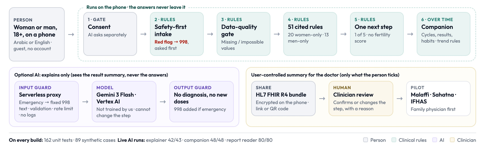

# Wiqaya: reproductive potential over time, for women and men

Prototype for the **Future Health Digital Innovation Challenge 2026**, Fertility Challenge 02: *Reproductive Potential*.

A private check in Arabic and English for women and men in Abu Dhabi, followed by a companion that tracks change over time: weekly check-ins (with cycle length for women), lab and hormone results, work exposures and the doctor's replies. There is no fertility score. Fixed, sourced rules explain what can and cannot be changed, what is still unknown, and which options are worth discussing now: healthy habits, tests, preconception counselling, a fertility-preservation discussion, a specialist, or urgent care.

What it adds beyond a questionnaire:

1. **A view of change over time.** Cycle lengths, AMH/FSH/TSH, semen analyses, blood pressure, weight and HbA1c are charted, and trend rules read the direction of change.
2. **Clinicians stay in charge.** A summary is encrypted on the phone and opened by link or QR code; the doctor confirms or changes the step, and that decision stands for 90 days. Every summary is marked for care only, never employment or insurance.
3. **A health-system view without individual data.** `/population` shows, on an invented population, which groups would benefit from earlier advice and whether advice reaches everyone fairly. Only totals are shown, and groups under 10 are hidden.
4. **Every claim is measured.** The Evidence page runs the rules live on 89 synthetic cases and reports calibration, false reassurance and the live-model AI tests.

Example people with months of history: `/#/try/mariam`, `/#/try/fatima`, `/#/try/omar`, `/#/try/yousef`.

> Screening support, not a diagnosis or a medical device. Tested with synthetic data only.

## How it works

| Stage | Who does it | What it does |
|---|---|---|
| Consent gate | Person | Nothing starts without consent. Each AI feature asks again, at the moment it is used. |
| Safety-first intake | Rules | Red-flag symptoms are asked right after age. Any red flag shows emergency or urgent advice straight away. |
| Lab report reader (optional) | AI, then code, then person | The AI transcribes numbers from a photo (`infra/ai/report.mjs`). Code straightens the picture first (`src/lib/deskew.ts`), then cross-checks the numbers against each other. The person confirms every value. |
| Data-quality gate | Rules | Catches missing, impossible and inconsistent values, ignores them, and asks the person to check. |
| Risk-signal rules | Rules | 51 deterministic rules, 20 of them for women only and 13 for men only (`src/lib/engine.ts`). Each shows the triggering answer and a guideline source. |
| Triage and navigation | Rules | One of five next steps; the highest wins. Offers lower-friction options. |
| Plain-language explainer (optional) | AI | Rewrites the result. It cannot change the step, and output guardrails block diagnosis claims and doses (`infra/ai/index.mjs`). |
| User-controlled hand-off | Person | The person picks what to share. An HL7 FHIR R4 bundle with a Consent resource (`src/lib/referral.ts`) is encrypted on the phone (`src/lib/crypto.ts`) and stored as ciphertext (`infra/server/share.mjs`). |
| Clinician review | Clinician | Confirms or changes the step with a reason (`/d/<link>` and `/clinician`). The decision returns, encrypted, to the person's phone. |

The AI never decides anything. The rules run on the phone.

## Architecture



| Part | Where it runs | Technology |
|---|---|---|
| Check, rules, companion, charts, encryption | On the person's device | React 19, TypeScript, Vite, Tailwind CSS; browser storage; Web Crypto (AES-256-GCM, HKDF) |
| AI proxy: explainer, grounded answers, visit preparation, care search, report reader | Serverless functions (`api/`, `infra/ai/`) | Gemini 3 Flash on Google Cloud Vertex AI, behind input validation, rate limits and output guardrails |
| Doctor link, feedback counters, shared rate limits | Serverless functions (`infra/server/`) | Upstash Redis; ciphertext and counters only |
| Hand-off format | Built on the device | HL7 FHIR R4 bundle with a Consent resource (`src/lib/referral.ts`) |

## Data and assumptions

**No model is trained or fine-tuned.** The next step comes from fixed rules; Gemini is used as provided, only to explain and to read report photos. No challenge dataset was provided and no real patient data was used at any point.

| Data | What it is | Used for |
|---|---|---|
| 89 synthetic cases (35 women's) | Written by the team from the cited guidelines, each with an expected next step (`src/eval/cases.ts`) | Rule accuracy, red flags, explainability, missing-data and fairness runs |
| 890 counterfactual runs | The same 89 cases across 5 nationality groups and 2 languages | Checks that the step never changes with nationality or language |
| 4 example people | Invented, with months of check-ins, results and doctor replies (`src/lib/companion/personas.ts`) | Showing change over time |
| 10,000 invented adults | Generated from rough planning assumptions, not from real statistics (`src/lib/population.ts`) | The health-system view; totals only |
| 18 synthetic report pictures | Computer-printed semen analysis reports, some tilted, dark or blurred, two that are not reports | Report reader tests |
| 48 sources, 37 notes | Published guidelines (ASRM, ACOG, ESHRE, NICE, WHO, AUA, EAU), cited and paraphrased, never reproduced | The rules and the grounded AI answers |

Assumptions: the person has a smartphone and internet access; a family physician or a women's health clinic is reachable; summaries can travel through existing Malaffi FHIR interfaces; Thiqa cardholders can book IFHAS.

## Clinical boundaries

- Screening and navigation support for adults (18+). **Not a diagnosis and not a medical device.**
- No fertility score, and no prediction of whether or when someone will conceive. AMH is never shown as a prediction of natural pregnancy.
- Fertility preservation appears only as a discussion to have with a clinician, never as a recommendation.
- Red-flag symptoms are asked first and stop the check with emergency (998) or same-day advice.
- The AI cannot change the step. Guardrails block diagnosis wording and any dose that is not quoted from the clinical notes.
- A clinician confirms or changes the step; that decision replaces the rules' suggestion for 90 days.

## What the server holds

| Data | Stored? | Detail |
|---|---|---|
| Answers and results | No | They stay in the browser's storage on the person's device. |
| Shared summary | Ciphertext only | AES-256-GCM, key derived (HKDF) from a secret that exists only in the link after the `#`. Deleted on withdrawal, or after 1 or 7 days. |
| Report picture | No | Passed to the model and dropped. Never logged. |
| Explainer request | No | Result titles and the suggested step only. Never logged. |
| Feedback | Counters | Two ratings, time taken, language. Nothing else is accepted. |
| Network address | Salted hash, up to 2 hours | Only for rate limits. |
| Page openings | Anonymous count, at PostHog | Page name, language, phone or desktop, time, country. No cookie, no page address, no answers (`src/lib/visits.ts`). Off unless `VITE_POSTHOG_KEY` is set. |

Request bodies are never written to logs.

## Run it

Needs Node 22 or newer.

```bash
npm install
npm run ai:dev                                      # API on :8787 (AI, hand-off, feedback), in-memory store
AI_PROXY_URL=http://localhost:8787 npm run dev      # app on http://localhost:5173
npm test                                            # unit tests (no network)
npm run build                                       # type-check, run tests, build to dist/
```

AI settings: copy `.env.example` to `.env.local` and fill in one of: a Google Vertex AI service-account key (Gemini, what the live demo uses), an OpenAI key, or the Azure OpenAI values. Or pass them as environment variables. If you use a service other than Vertex AI, set `VITE_AI_PROVIDER` to its name when building, so the consent text names the right service. Keys are never committed. Without them the AI features answer "not available" and everything else works.

Use `localhost`, not a LAN address, to try the private link: browsers only allow encryption on a secure address.

## Deploy (Vercel)

1. `npx vercel deploy --prod` from this folder. `vercel.json` sets the build, headers and function limits.
2. Add the **Upstash for Redis** integration to the project (Storage tab). It sets `KV_REST_API_URL` and `KV_REST_API_TOKEN`, which turn on the private link, the feedback counters and the shared rate limits.
3. Set `GCP_SERVICE_ACCOUNT_JSON` in the project settings (the contents of a Google Cloud service-account key with the Vertex AI User role) to turn on the AI features. An `OPENAI_API_KEY`, or the Azure OpenAI values in `.env.example`, work instead. Optional: `OPENAI_BACKUP_API_KEY` answers any call the main service refuses; name both services in `VITE_AI_PROVIDER` so the consent text stays true.

Each part degrades on its own: without the store the hand-off stays on the device, and without the AI key the numbers are typed by hand.

The AWS scripts in `infra/aws` deploy the static app and the explainer only.

## Testing

| What | How | Where the result shows |
|---|---|---|
| Rules engine | 89 synthetic cases, run live in the browser: 89/89 expected step, 13/13 red flags, none under-triaged | `/evaluation` |
| Fairness | 890 counterfactual runs (5 nationality groups, 2 languages): 890/890 unchanged | `/evaluation` |
| AI explainer | 43 live calls in English and Arabic, women and men: `npm run ai:eval` (42/43 on Gemini) | `/evaluation` |
| AI companion (answers, care search, visit preparation) | 48 live calls: `npm run ai:eval:companion` (48/48) | `/evaluation` |
| Lab report reader | 18 synthetic pictures, live model: `npm run ai:eval:reports` (80/80 values, 2/2 non-reports refused) | `/evaluation` |
| Hand-off, feedback, rate limits, report checks | Unit tests: `npm test` | Build fails if any fails |
| Encryption | Self-test in the visitor's browser | `/evaluation` |

The report pictures are generated by `npm run fixtures` (needs Chrome and ffmpeg): five layouts, as screenshots and as tilted, dark or blurred phone-style pictures, one with a result taped over, plus two pictures that are not semen analyses.

## Limits to know about

- Expected results for the 89 cases were written by the team from guidelines. They **still need independent clinician labelling**.
- The report reader was tested on synthetic, computer-printed reports only. Real reports with stamps, handwriting, glare or folds are not measured yet.
- The private link is a prototype channel. Anyone holding the link can read the summary until it expires or is withdrawn, and the clinician is not signed in. A pilot would deliver through Malaffi with clinician sign-in.
- The Arabic text needs review by a native-speaking clinician.
- Everything was tested with synthetic data. Validation with real patients belongs to a supervised pilot.
- In the public demo the server store is not switched on, so the encrypted doctor link falls back to a demo on the device.

## Pages

`/` home · `/check` consent and check-in · `/result` · `/report` lab report reader · `/share` summary and private link · `/d/<link>` what the doctor opens · `/clinician` inbox · `/me` the plan over time · `/population` health-system view · `/evaluation` evidence · `/privacy` · `/how` · `/example/C44` instant sample result · add `?lang=ar` to any link for Arabic.
